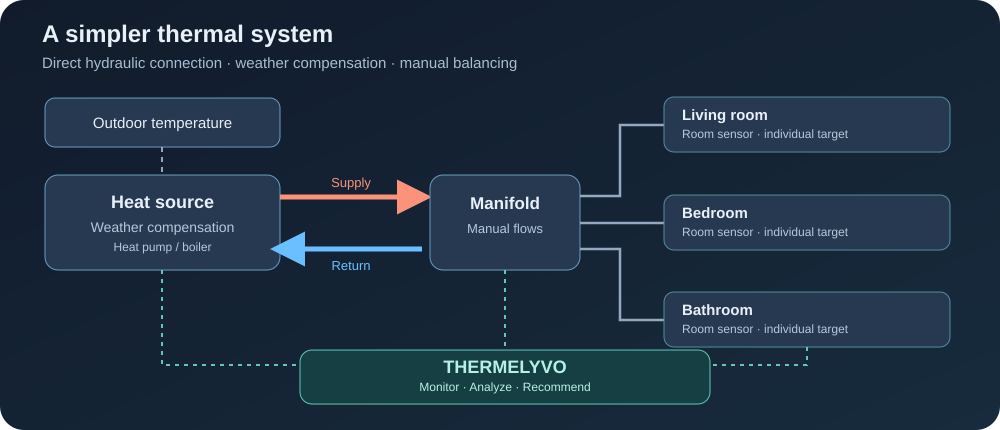

# THERMELYVO

**Smart Heating & Cooling Analytics**

### Simplicity. Balance. Efficiency.

Local, read-only thermal and energy analytics for Home Assistant.

[Overview](#what-it-does) · [How it works](#how-it-works) · [Install](#installation) · [Support](#support) · [Română](docs/README.ro.md)

---

## What it does

THERMELYVO helps you understand, balance and optimize a hydronic heating or cooling system using your own Home Assistant sensors and manual flow readings.

| Understand | Balance | Optimize |
| :--- | :--- | :--- |
| Room temperatures and individual targets | Identify persistent room-to-room temperature differences | Review the weather-compensation curve only after relative thermal balance |
| Supply, return, flow and energy measurements | Record circuit flow adjustments and compare their effects | Track heat-pump performance, energy use and operating costs |

**It monitors, analyzes and recommends. You remain in control.** No equipment control commands, external AI service or mandatory cloud connection.

## How it works

Our focus is on simple, well-designed hydronic systems: weather compensation, direct supply and return, manually balanced circuits, and room temperature sensors for monitoring rather than on/off control.

Where the equipment and installation allow, avoid unnecessary buffer tanks, mixing groups, secondary pumps and room actuators. Always follow the manufacturer's requirements for minimum flow, water volume, safety devices and condensation protection.

### Balance first. Then optimize.

1. **Hydraulic balance** — record circuit flows and adjust the distribution manually.
2. **Thermal balance** — compare each room against its own target and allow the building to settle.
3. **Weather compensation** — review the curve only when all rooms served by the source are relatively balanced and the building is consistently too warm or too cold.

A warm room and a cold room are not a reason to raise or lower the entire heating curve. A shared temperature offset across balanced rooms may be.

## Inside THERMELYVO

The bilingual panel includes a compact comfort dashboard, guided configuration, room and circuit views, manual adjustment history and an expert analysis mode.

- **Comfort:** room targets, temperature deviations and local history.
- **Hydraulics:** manifolds, circuit flow records, adjustments and reference profiles.
- **Energy:** supply/return temperatures, thermal power, COP or measured energy ratios, consumption, costs and defrost history, where data supports them.
- **Cooling:** temperature monitoring and dew-point/condensation indicators. Independent physical safeguards are still required.
- **Data:** reviewed reports, CSV/JSON export and native Home Assistant backup preparation.

## Installation

> **Development beta — not a stable release.** Install on a test system first and make a current Home Assistant backup.

1. Add this repository as a custom **Integration** in HACS and download the available development version.
2. Restart Home Assistant if required.
3. Go to **Settings → Devices & services → Add integration**, search for **THERMELYVO**, and add it.
4. Open **THERMELYVO** in the sidebar and select **Set up home** to configure your rooms, circuits, heat sources and sensors.

The configuration shortcut is not an installer. [Detailed installation, upgrade and backup instructions](docs/INSTALLATION.md).

**Existing users:** THERMELYVO is the new name of irPaT & Eficiență. The internal integration domain and storage identity remain unchanged to preserve configuration, history and compatibility. No fresh install or reset is intended.

## Project status

Active development. Heating recommendations require adequate aligned history, comparable operating conditions and review by the user. The project does not certify hydraulic balance or guarantee savings. Cooling curve optimization is not currently supported.

[Implementation status](IMPLEMENTATION_STATUS.md) · [Algorithms](ALGORITHMS.md) · [Architecture](ARCHITECTURE.md) · [Roadmap](ROADMAP.md) · [Test runs](https://github.com/mirel2505/irpat-efficiency/actions)

## Support

Report a bug or suggest an improvement through [GitHub Issues](https://github.com/mirel2505/irpat-efficiency/issues). Include your Home Assistant version, THERMELYVO version and relevant anonymized screenshots or logs. Do not share access tokens, private URLs or personal information.

If this project helps you, voluntary contributions support development and maintenance. No features are paywalled.

---

**THERMELYVO** · Simplicity. Balance. Efficiency.

Open source under the [GNU GPL v3.0](LICENSE).

