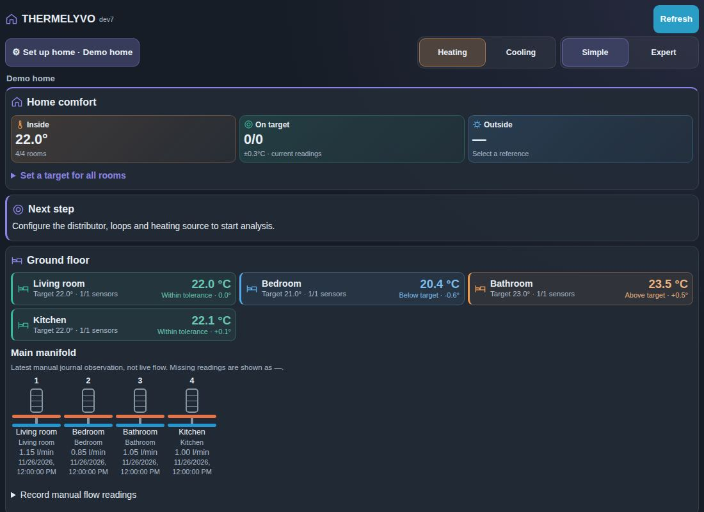
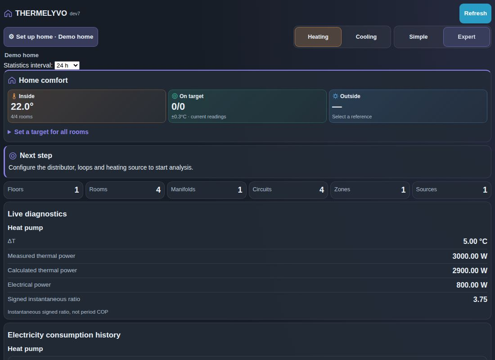
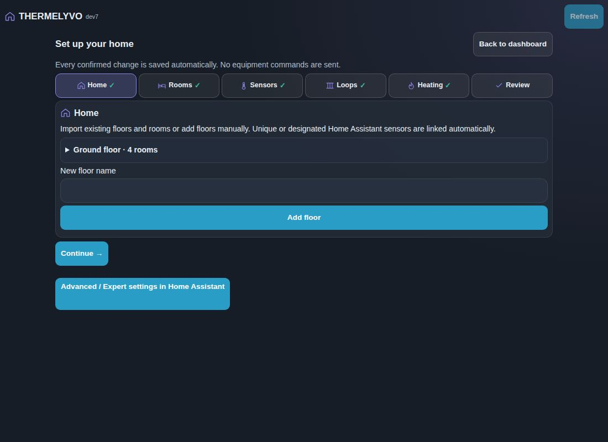
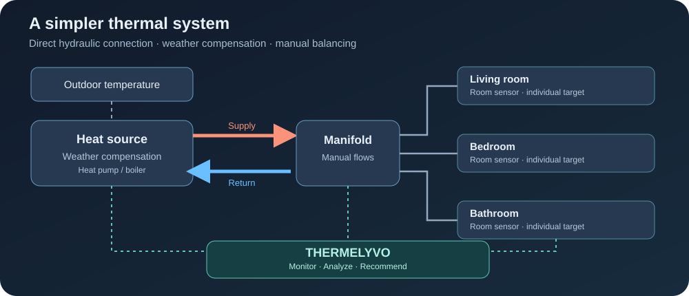

# THERMELYVO

**Smart Heating & Cooling Analytics**

### Simplicity. Balance. Efficiency.

Mai puțină complexitate. Mai multă eficiență.

[English](../README.md) · [Instalare](INSTALLATION.md)

THERMELYVO este o integrare locală pentru Home Assistant, dedicată monitorizării, analizei și optimizării instalațiilor de încălzire și răcire cu agent termic.

 Captură reală a interfeței, cu date demonstrative și configurare parțială.

## Ce face

- Monitorizează temperaturile și țintele individuale ale încăperilor.
- Identifică dezechilibrele termice și recomandă direcția de ajustare a debitelor.
- Înregistrează reglajele hidraulice și urmărește efectele acestora în timp.
- Recomandă analiza curbei meteo numai după echilibrarea relativă a încăperilor alimentate de aceeași sursă și confirmarea unei abateri termice generale.
- Monitorizează turul, returul, puterea termică, energia, COP-ul și degivrările când există măsurători adecvate.
- Oferă un configurator grafic, un panou simplu/expert, rapoarte și export de date.

<table><tr><td width="50%"></td><td width="50%"></td></tr><tr><td align="center"><b>Analiză Expert</b></td><td align="center"><b>Configurare ghidată</b></td></tr></table>

## Filosofie

Meteoreglare, echilibrare hidraulică și echilibrare termică. Preferăm instalații directe, fără componente și automatizări inutile, acolo unde sunt respectate cerințele tehnice ale echipamentelor. Senzorii ambientali sunt utilizați pentru monitorizare, nu pentru comanda încălzirii.

**Nu automatizăm dezechilibrul. Eliminăm cauzele acestuia.**

Integrarea oferă recomandări consultative, nu comandă echipamentele și nu garantează economii. Este necesară protecție independentă împotriva condensului în răcire.

## Instalare Beta 1

Adaugă repository-ul ca integrare personalizată în HACS, selectează versiunea pre-release `0.1.0-beta.1` (activează afișarea versiunilor beta dacă este necesar), repornește Home Assistant dacă este necesar și caută **THERMELYVO** în Devices & services. Deschide panoul din meniul lateral pentru configurare.

Fă un backup înainte de actualizare. Domeniul tehnic vechi este păstrat pentru compatibilitate. Proiectul este în dezvoltare, fără versiune stabilă.

## Suport

[Raportează o problemă sau propune o îmbunătățire](https://github.com/mirel2505/irpat-efficiency/issues). Nu publica date personale sau tokenuri.

[Donații voluntare – Buy Me a Coffee](https://buymeacoffee.com/rmirel2505o) · [Licență GPL-3.0](../LICENSE)
